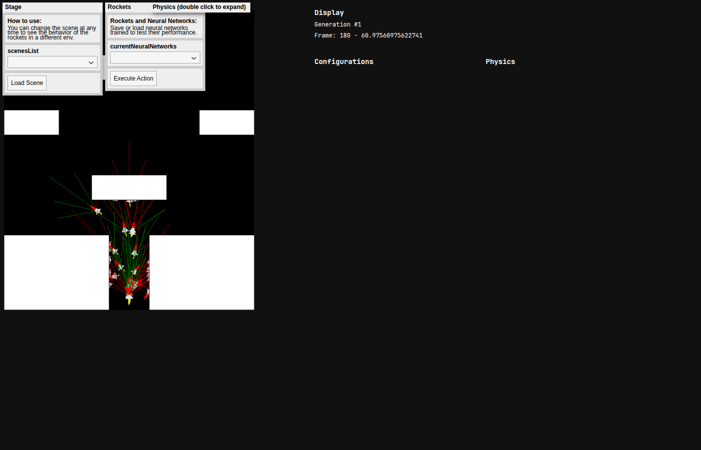
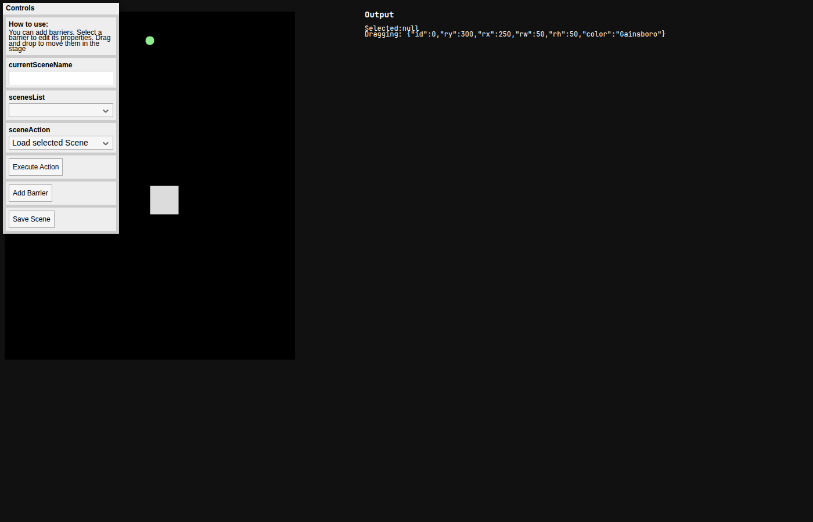

# Sentient Rockets Sandbox

A p5.js + TensorFlow.js sandbox where rockets learn to fly with a genetic algorithm. Each rocket senses obstacles and is steered by its own neural network.

**Live demo:** https://dservidie.github.io/sentient-rockets/



This is an improved version of [Smart Rockets](https://codepen.io/daniel-servidie/pen/pogegWL). Rockets no longer follow a fixed list of commands. They sense the environment and react.

## How it works

Each rocket has five range sensors (rays) plus a few flight readings. Those values are the inputs to a small neural network. The network outputs a fly instruction: thrust and steering.

**Inputs (8):**

- Horizontal and vertical velocity
- Current steering acceleration
- Five boolean sensor flags (1 if that ray hits a barrier or the world edge, otherwise 0)

**Network:** 8 inputs → 16 hidden neurons (sigmoid) → 2 outputs (sigmoid)

**Outputs:**

- Thrust (0–1)
- Steering (mapped from 0–1 to left/right)

The first generation starts with random weights. After a generation finishes, the top-performing rockets are copied into the next generation with small random mutations. Over time, useful behaviors can spread through the population.

Built-in scenes: `corridor` and `wide-gap`. You can also make your own in the [scene designer](https://dservidie.github.io/sentient-rockets/scene-designer/).



## Transfer a brain between scenes

A brain is the network topology plus its weights, saved as a JSON file.

1. Train rockets in one scene (`corridor`, `wide-gap`, or a scene from the designer).
2. Click **Export best brain**. That downloads a JSON file and also keeps a copy in the page.
3. Pick a different scene and click **Load scene**.
4. Click **Load brain** and choose the JSON file.
5. **Evaluate loaded brain** runs that same network with no mutation and reports how it did.
6. **Continue training from loaded** seeds the next generation from those weights instead of random ones.

The file stores input/hidden/output sizes and every weight, so the same brain can fly in another layout.

## Rocket controls

Rockets are controlled by thrust and steering.

To try the physics by hand, use this CodePen:
https://codepen.io/daniel-servidie/pen/pogegWL

## Watch the neural network learn in front of your eyes

https://dservidie.github.io/sentient-rockets/

## Tests

```
npm test
npx playwright install chromium
npm run test:e2e
```

`npm test` runs the unit tests (networks, fitness, physics, sensors, scenes, brain save/load). `npm run test:e2e` serves the site and checks the sim, the scene designer, and a brain moving from `corridor` to `wide-gap`.
